# PIXONA — Battle System

Motor de combate por turnos con estética *Persona* (rojo/blanco/negro, menús inclinados).

HTML + CSS + JavaScript puro (módulos ES), **sin bundler, sin dependencias y sin paso de
compilación**.

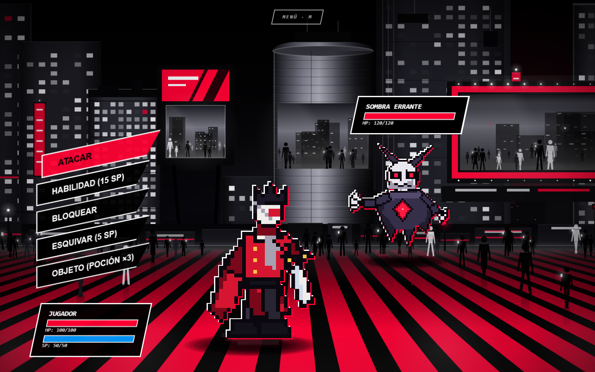

## Publicar en GitHub Pages

El proyecto es 100% estático: GitHub Pages publica `index.html`, `css/`, `js/`, `data/`
y `assets/` tal cual. **No hay que compilar nada.**

1. Crea un repositorio en GitHub y sube el contenido de esta carpeta a la rama `main`:

   ```bash
   git init
   git add .
   git commit -m "PIXONA"
   git branch -M main
   git remote add origin https://github.com/<usuario>/<repo>.git
   git push -u origin main
   ```

2. En el repositorio, entra a **Settings → Pages → Build and deployment**:
   - **Source**: `Deploy from a branch`.
   - **Branch**: `main` y carpeta `/ (root)`.

3. Espera uno o dos minutos y abre `https://<usuario>.github.io/<repo>/`.

Todas las rutas son relativas, así que funciona igual en `usuario.github.io` que en
`usuario.github.io/repo/`. El archivo `.nojekyll` evita que GitHub Pages procese el sitio
con Jekyll. No necesitas servidor, `npm` ni un workflow de Actions para publicarlo.

## Cómo jugar en local

El proyecto usa módulos ES y `fetch`, así que **no funciona abriendo `index.html` con
doble clic** (el navegador bloquea módulos desde `file://`). Necesita un servidor local:

**1. Doble clic en `start.bat`** (Windows, lo más simple)

Abre el servidor y el navegador automáticamente. Cierra la ventana para detenerlo.

**2. `npm start`**

Si tienes Node.js instalado:

```bash
npm start          # abre el navegador
npm run serve      # solo el servidor
```

**3. Cualquier servidor estático**

```bash
python -m http.server 5173
```

Luego abre <http://localhost:5173/>.

## Controles

| Acción | Teclado | Ratón |
|---|---|---|
| Mover el cursor | `W` / `S` o `↑` / `↓` | pasar el cursor por encima |
| Confirmar | `Enter` o `Z` | clic |
| Abrir el menú principal | `M` | botón `MENÚ` (arriba al centro) |
| Cerrar / volver | `Esc` | clic en el fondo rojo |
| Reiniciar tras los resultados | `Enter` | botón `VOLVER A JUGAR` |

**Acciones:** Atacar · Habilidad (15 SP, ×1.5 daño) · Bloquear (−50% daño recibido) ·
Esquivar (5 SP, +50% evasión) · Objeto (Poción, cura 40 HP, 3 cargas).

Los mensajes del combate aparecen en el registro de la esquina inferior derecha.

## Turnos y golpes

Cada turno se anuncia con una banda central y con un **chip permanente** bajo el botón
`MENÚ`:

- **TU TURNO** — banda del color de acento; el jugador puede elegir acción.
- **TURNO DEL ENEMIGO** — banda negra con texto rojo; la sombra se prepara.

La banda queda **detrás del HUD**, así que nunca tapa los botones ni las fichas de
HP/SP. El personaje al que le toca el turno **crece un 7 %** con una transición suave;
el otro vuelve a su tamaño normal.

Los ataques son más lentos y tienen fases: la animación arranca, el daño impacta a los
~250 ms (no al pulsar el botón), el atacante se recupera durante otros ~350 ms y el turno
espera una pausa de ~250 ms antes de cambiar. Así se ve el impulso, el golpe y la
reacción antes de que aparezca el siguiente turno.

Los golpes añaden un número flotante sobre la ficha del herido (`-20`, `ESQUIVA`,
`BLOQUEO -12`), un destello de pantalla (blanco al golpear a la sombra, rojo al recibir)
y un temblor breve de la escena.

| Turno del jugador | Turno del enemigo | Impacto |
|---|---|---|
| 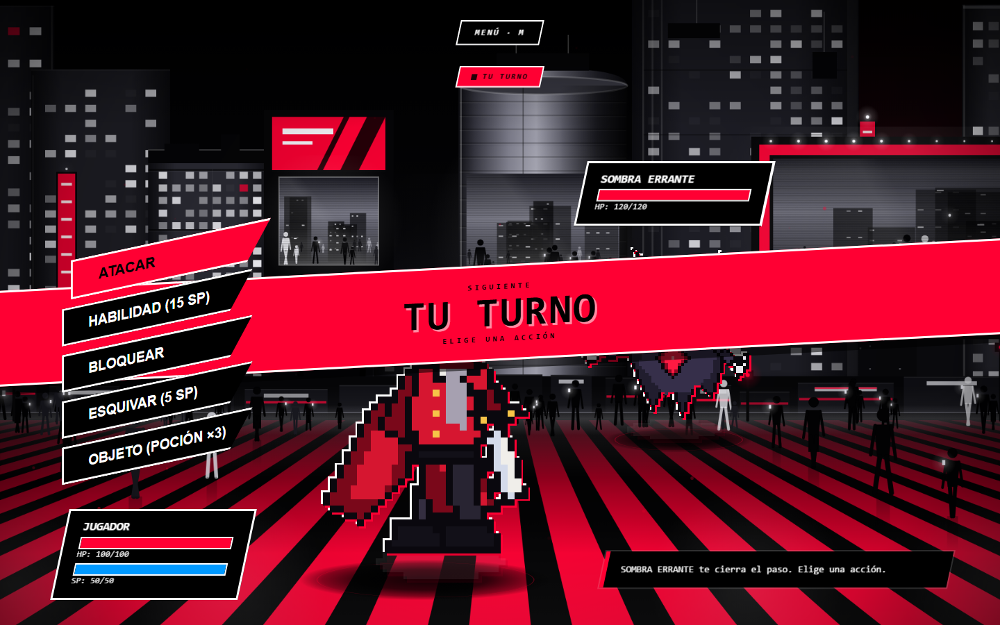 | 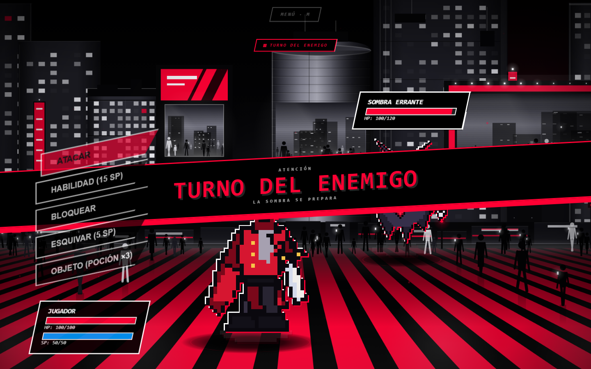 | 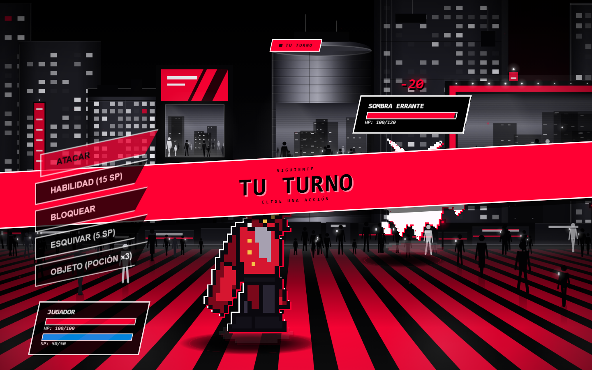 |

## Tanda de cinco sombras

Al derrotar a una sombra, un fundido negro presenta a la siguiente y la batalla continúa
automáticamente. Son **cinco oponentes** con más HP, ataque y tamaño; entre combate y
combate el jugador recupera todo el HP/SP. Al caer la quinta sombra aparece la pantalla
de **resultados** con el desglose de EXP, dinero y botín de toda la tanda. Si el jugador
cae antes, la misma pantalla muestra la derrota y las sombras que sí derrotó.

| Transición | Resultados |
|---|---|
| 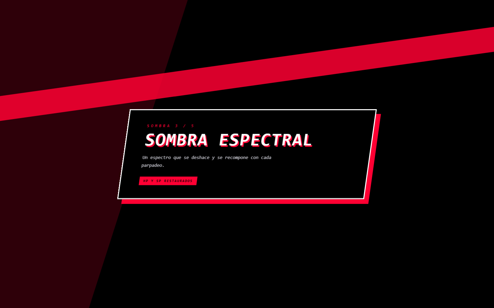 | 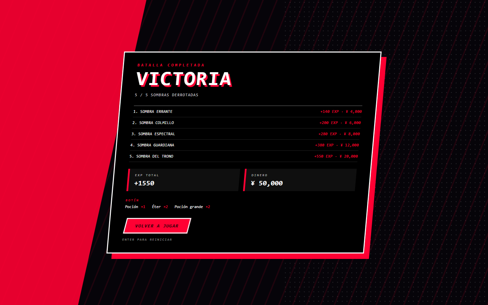 |

## Estructura

```
index.html               canvas + capa de UI (paneles, menú, registro de combate)
.nojekyll                evita el procesado de Jekyll en GitHub Pages
css/main.css             estilos estilo Persona
data/characters.json     estadísticas base, Persona, inventario y equipo inicial
data/animations.json     metadatos de los spritesheets (frames, fps)
data/enemies.json        las cinco sombras: estadísticas, tamaño, EXP, dinero y botín
data/weapons.json        armas disponibles (ATK/DEF y retroceso)
data/equipment.json      armaduras (DEF/EVA/VEL) y accesorios (EVA/VEL)
data/items.json          catálogo de objetos (curación / SP)
data/requests.json       peticiones pendientes y completadas
assets/                  imágenes (hero_spritesheet.png, enemy_spritesheet.png,
                         background.png)
js/main.js               arranque: carga datos, crea el motor y el bucle de render
js/logic/Fighter.js      HP/SP, equipo, daño, evasión, bloqueo y objetos
js/logic/BattleEngine.js máquina de estados de turnos
js/logic/BattleFlow.js   encadena las cinco sombras y acumula EXP/dinero/botín
js/ui/BattleMenu.js      menú de combate con teclado y ratón
js/ui/UIController.js    barras, registro y feedback de turnos/golpes
js/ui/TurnBanner.js      anuncio central de turno + chip permanente
js/ui/MainMenu.js        menú principal de pantalla completa
js/ui/EncounterTransition.js  fundido y tarjeta del siguiente oponente
js/ui/ResultScreen.js    pantalla final de EXP, dinero y botín
js/graphics/             renderizador del fondo, sombras y animador de sprites
js/utils/DataLoader.js   carga de JSON e imágenes
js/utils/dom.js          helpers createNode/createButton para construir DOM
serve.ps1 / start.bat    servidor de desarrollo local (no se usa en GitHub Pages)
docs/                    capturas (combate, turnos, golpes, transición, resultados,
                         menú, persona, peticiones, stats, calendario, sistema)
```

## Arquitectura: cómo se comunican los archivos

El proyecto separa **datos**, **lógica** y **presentación**, y las conecta en un único
punto de composición: `js/main.js`.

- **Datos** (`data/*.json`, `assets/*.png`): no ejecutan nada; son la fuente de verdad.
- **Lógica** (`js/logic/`): reglas de combate y de la tanda. No toca el DOM.
- **Presentación** (`js/ui/`, `js/graphics/`): HUD, menú, transiciones y escena.
- **Composición** (`js/main.js`): carga todo, crea los objetos y cablea los callbacks.

### Mapa de dependencias

```text
index.html
├── css/main.css                    estilos de paneles, menú y overlays
└── js/main.js                      punto de entrada (DOMContentLoaded)
    ├── utils/DataLoader.js ──fetch──► data/*.json
    │                       └─Image──► assets/*.png
    ├── logic/Fighter.js ◄── catalogs { items, weapons, equipment }
    ├── logic/BattleFlow.js
    │   ├── logic/BattleEngine.js ──► logic/Fighter.js
    │   ├── ui/UIController.js ─────► ui/BattleMenu.js
    │   │                        └──► ui/TurnBanner.js
    │   ├── ui/EncounterTransition.js
    │   └── ui/ResultScreen.js ─────► utils/dom.js
    ├── ui/MainMenu.js ─────────────► utils/dom.js
    ├── graphics/BackgroundRenderer.js
    ├── graphics/SpriteAnimator.js
    └── graphics/GroundShadow.js
```

Una flecha `→` significa «importa o llama a». `main.js` es el único que conoce todas
las piezas: por eso puede pasar callbacks de la lógica a la interfaz sin que esas dos
capas se importen entre sí.

### Acción de combate

```text
jugador (clic o tecla)
   │
   ▼
ui/BattleMenu.js ── data-action ──► ui/UIController.js
                                        │ callback onActionSelect
                                        ▼
                                  js/main.js
                                        │ flow.engine.executePlayerAction(action)
                                        ▼
                                  logic/BattleEngine.js
                                    ├─ logic/Fighter.js            daño, HP/SP, evasión
                                    ├─ ui/UIController.js          barras, registro y golpes
                                    ├─ ui/TurnBanner.js            anuncio y chip de turno
                                    └─ graphics/SpriteAnimator.js  animaciones + impulso
                                        │
                                        ▼
                        PLAYER_TURN / ENEMY_TURN / VICTORY / DEFEAT
```

`BattleEngine` no toca el DOM: habla con `UIController`, que es quien conoce los ids y
las clases CSS. Tampoco dibuja: pide `playOnce(...)` a los animadores.

### Victoria y tanda de cinco sombras

```text
BattleEngine (VICTORY)
   │ onVictory (callback)
   ▼
logic/BattleFlow.js
   ├─ suma XP / dinero / botín (data/enemies.json)
   ├─ sombras 1–4: ui/EncounterTransition.js
   │     └─ onCovered → advance() → engine.enter(nuevo Fighter) + HP/SP al máximo
   └─ sombra 5: ui/ResultScreen.js (resumen y reinicio)
```

### Menú principal

```text
tecla M / botón MENÚ
   │
   ▼
ui/MainMenu.js ── callbacks ──► js/main.js
   │                               ├─ onEquipWeapon/Armor/Accessory → logic/Fighter.js
   │                               ├─ onSelectItem → BattleEngine.setActiveItem()
   │                               ├─ onAccentChange → CSS --accent + sombras + contorno
   │                               ├─ onFontChange → tamaño de texto raíz
   │                               └─ onOpen/onClose → UIController bloquea/activa el menú
   └─ utils/dom.js (createNode / createButton)
```

`MainMenu` no modifica el combate por su cuenta: aplica el cambio mediante los
callbacks de `main.js` y luego repinta el panel con `refreshPanel()`.

### Contrato de cada archivo de datos

| Archivo | Lo consume | Para qué |
|---|---|---|
| `data/characters.json` | `main.js` → `Fighter`, `MainMenu` | Stats base, Persona, inventario y equipo inicial. |
| `data/enemies.json` | `BattleFlow` → `Fighter`; bucle de render | Stats, altura, EXP, dinero y botín de las cinco sombras. |
| `data/weapons.json` | `Fighter`, `MainMenu`, `BattleEngine` | Bonificaciones de ATK/DEF y retroceso de cada arma. |
| `data/equipment.json` | `Fighter`, `MainMenu` | Armaduras (DEF/EVA/VEL) y accesorios (EVA/VEL). |
| `data/items.json` | `Fighter`, `BattleEngine`, `MainMenu`, `ResultScreen` | Curación/SP y nombres del botín. |
| `data/requests.json` | `MainMenu` | Peticiones pendientes y completadas. |
| `data/animations.json` | `main.js` → `SpriteAnimator` | Tamaño de frame, frames y fps. |
| `assets/*.png` | `main.js` → `BackgroundRenderer`, `SpriteAnimator` | Fondo y spritesheets. |

### Reglas para no romper las capas

- `logic/` no usa `document`, `querySelector` ni clases CSS.
- `graphics/` solo recibe un `ctx` y dibuja; no lee datos del juego salvo lo que se le pasa.
- `ui/` no cambia reglas de combate: `MainMenu` muta el `Fighter` por callbacks y
  `BattleMenu` solo envía la acción elegida.
- `main.js` es el único que crea los objetos y conecta unos con otros.
- Los JSON son la fuente de verdad: cambia el balance ahí antes que en el código.

## Menú principal

Se abre con `M` o con el botón **MENÚ** del centro de la pantalla, y pausa el combate.

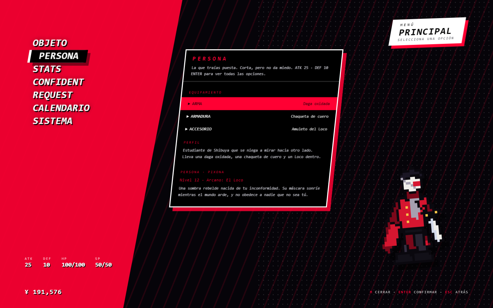

- **OBJETO** — elige qué objeto usará el comando `OBJETO` durante el combate. Las cargas
  se muestran y bajan al usarlas; el botón del combate refleja el objeto activo.
- **PERSONA** — descripción del jugador y de PIXONA, más el **equipamiento**. Al
  confirmar ARMA, ARMADURA o ACCESORIO se despliega la **lista completa de esa
  categoría** con sus stats (ATK/DEF, DEF/EVA/VEL o EVA/VEL), la pieza equipada marcada
  con ▶ y `ENTER` para equipar; `ESC` vuelve a las ranuras. La armadura suma `DEF` y
  puede ajustar `EVA`/`VEL`; los accesorios ajustan `EVA` y `VEL`. El **Mandoble
  sangriento** da mucho más ATK a cambio de 14 HP de retroceso por golpe.
- **STATS** — atributos del Persona (FUERZA · MAGIA · RESISTENCIA · AGILIDAD · SUERTE)
  con barras sobre 99, más los derivados (HP/SP/ATK/DEF/EVA/VEL) y el equipo completo.
  Los atributos salen de `player.persona` en `data/characters.json` y por ahora son
  **solo de exhibición**: no modifican el combate.
- **REQUEST** — peticiones de Shibuya separadas en **PENDIENTES** y **COMPLETADAS**,
  con cliente, lugar, objetivo y recompensa.
- **CALENDARIO** — rejilla del mes actual con los días ya pasados en rojo y el día de
  hoy en blanco.
- **SISTEMA** — cambia el **color de acento** de la interfaz (y de las sombras de los
  personajes) entre seis temas, y el **tamaño del texto** (S / M / L / XL). Incluye
  RESTABLECER. En el combate, el HUD limita su crecimiento en L/XL para no tapar la
  ficha del jugador.
- **CONFIDENT** — de momento muestra un panel sin contenido.

Las estadísticas del panel inferior izquierdo se actualizan al equipar. Al cerrar el
menú, el combate continúa donde estaba.

| PERSONA · ARMA | REQUEST |
|---|---|
| 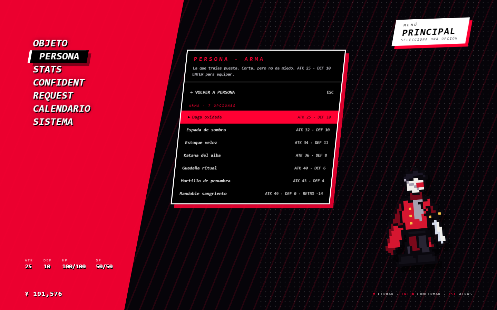 | 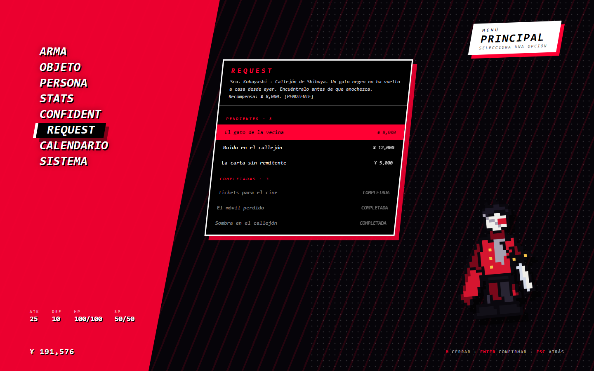 |

| STATS | CALENDARIO | SISTEMA |
|---|---|---|
| 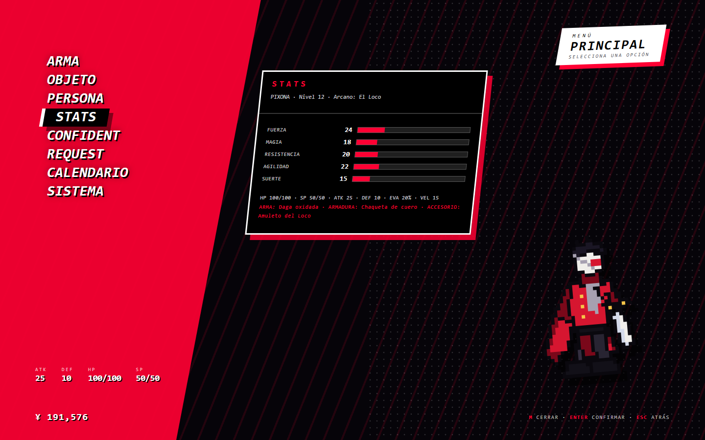 | 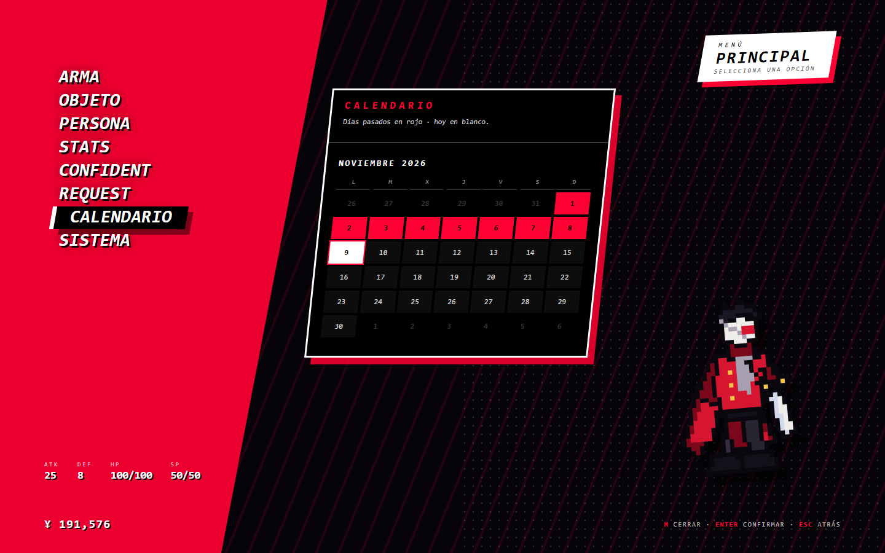 | 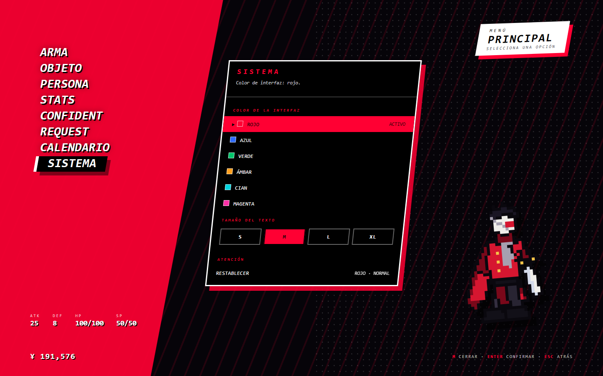 |

## Los spritesheets y el fondo

Los sprites y el fondo son **placeholders**; sustitúyelos por tu propio arte:

| Archivo | Rejilla | Animaciones |
|---|---|---|
| `assets/hero_spritesheet.png` | 8 frames de 48×48 (4×2) | `idle` 0–3 · `attack` 4–7 |
| `assets/enemy_spritesheet.png` | 16 frames de 64×64 (4×4) | `idle` 0–3 · `attack` 4–7 · `hurt` 8–11 · `defeat` 12–15 |

El enemigo se dibuja mirando a la izquierda, así que su arte no necesita volteo.

Puedes sustituirlos por tu propio arte manteniendo la rejilla, o ajustar
`frameWidth`, `frameHeight` y los índices de frames en
`data/animations.json`. El tamaño del héroe está en `ENTITY_LAYOUT` (`js/main.js`); el
de cada sombra sale de su `height` en `data/enemies.json`, así que las últimas se ven
más grandes.

Los sprites llevan un **contorno dinámico de dos colores** generado en tiempo de
ejecución a partir de su alfa: blanco arriba-izquierda y el color de acento de SISTEMA
abajo-derecha. No hace falta dibujar el contorno en el PNG; el brillo y el color se
adaptan al tema sin modificar los spritesheets.

El fondo de combate es `assets/background.png` (1920×1080). Si lo reemplazas,
mantén esa proporción: la línea del suelo está en y≈726, los pies del héroe en
y≈1004 y los del enemigo en y≈762.

## Notas

- El estado de la partida empieza al máximo de HP/SP (`maxHp` y `maxSp` en el JSON);
  el JSON ya no repite `hp`/`sp`.
- La tanda son cinco combates seguidos; entre uno y otro se restauran HP y SP. No hay
  guardado: al reiniciar desde los resultados se recarga la página.
- Las peticiones de REQUEST son contenido estático: no cambian de estado ni pagan la
  recompensa.
- Todo el equipo está disponible desde el principio (no hay tienda ni inventario de
  armaduras).
- El **Mandoble sangriento** quita 14 HP al atacante con cada golpe; el retroceso se
  muestra en rojo sobre la ficha del jugador.
- El tema y el tamaño de texto se reinician al recargar (no hay `localStorage`).
- No hay sonido. El héroe no tiene animación de `hurt`/`defeat`: solo el enemigo las
  tiene, así que al recibir daño el héroe no se estremece.
- Los atributos del Persona (STR/MAG/END/AGI/LUK) son solo de exhibición.
