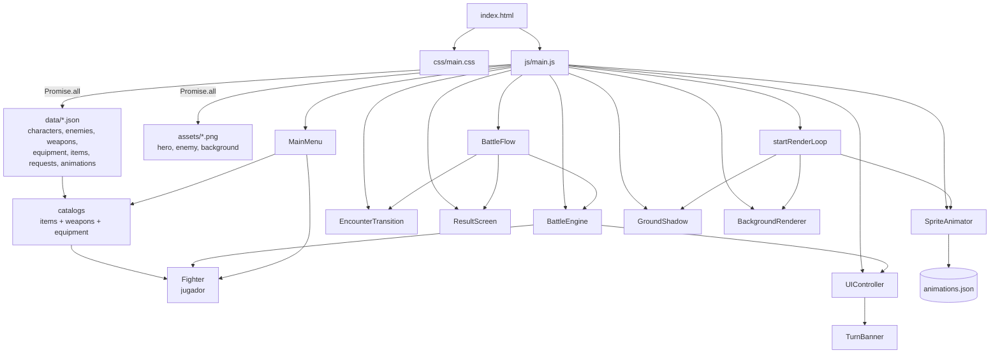
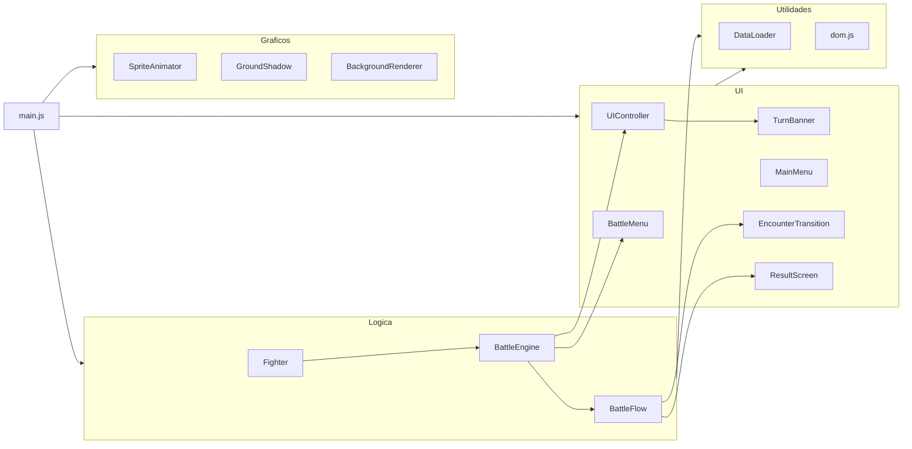
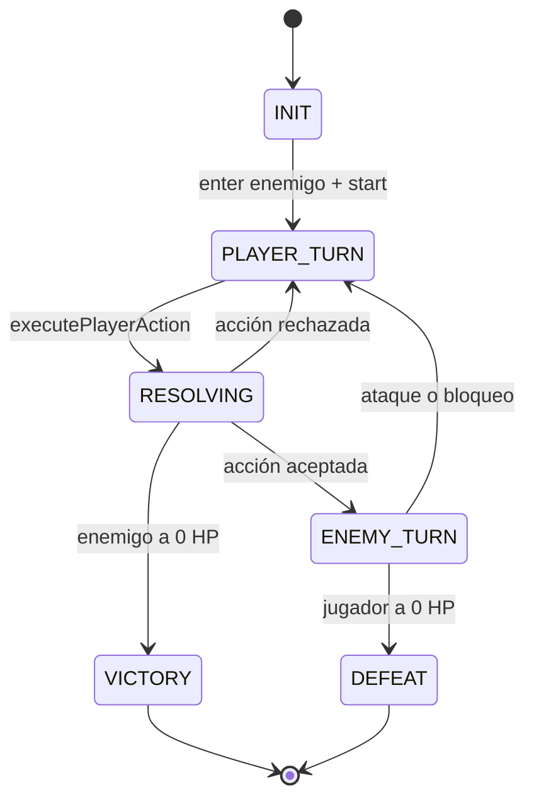
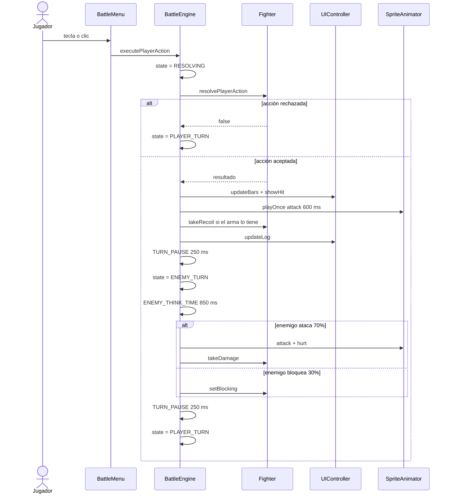
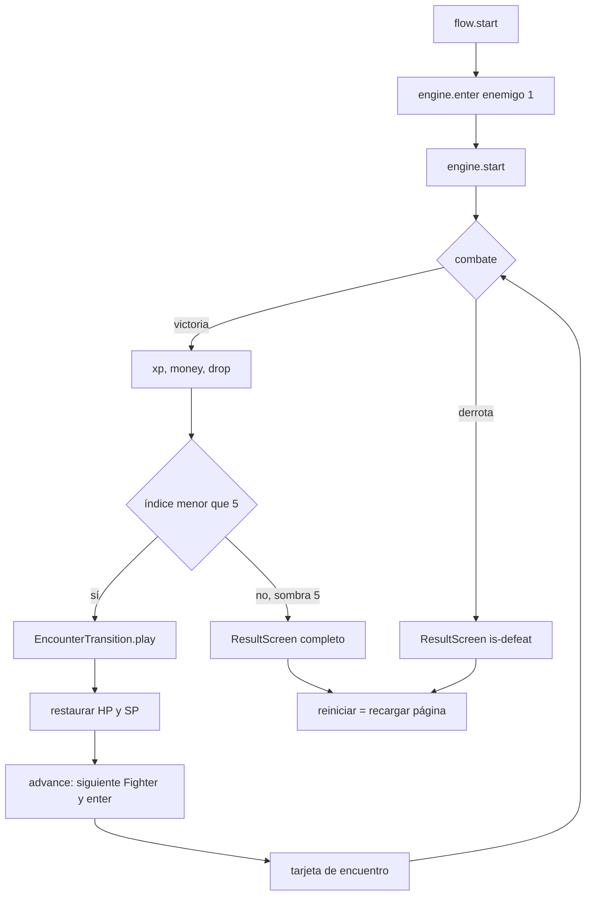
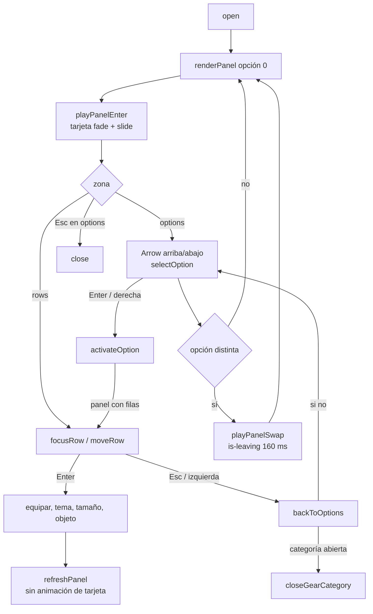
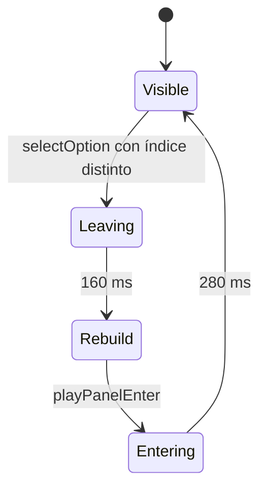
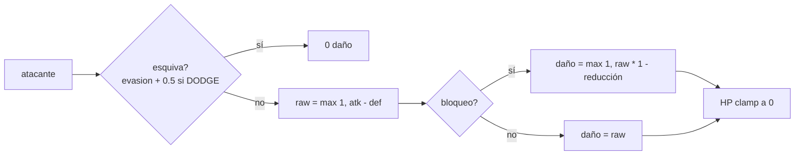

# PIXONA — arquitectura y flujo

> **Cómo usarlo:** este archivo tiene **varios** diagramas. Mermaid Live y la
> mayoría de visores aceptan **un solo diagrama por documento**, así que:
>
> 1. Abre el generador (mermaid.live, draw.io, etc.).
> 2. Borra todo lo que haya en el editor.
> 3. Copia **solo el contenido entre las vallas** de un bloque ` ```mermaid `.
>    No copies el título, la valla, ni texto como este.
> 4. Pega y listo.
>
> Si pegas el archivo completo o el título Markdown, sale
> `UnknownDiagramError: No diagram type detected`.

**Versión lista para copiar:** cada diagrama está también como archivo suelto
en [`docs/diagramas/`](diagramas/), sin vallas ni Markdown. Abre uno, `Ctrl+A`,
`Ctrl+C` y pégalo en el generador:

| Bloque | Archivo |
|---|---|
| 1. Arranque | [`01-arranque.mmd`](diagramas/01-arranque.mmd) |
| 2. Capas | [`02-capas.mmd`](diagramas/02-capas.mmd) |
| 3. Estados del combate | [`03-estados-combate.mmd`](diagramas/03-estados-combate.mmd) |
| 4. Turno | [`04-turno.mmd`](diagramas/04-turno.mmd) |
| 5. Run de sombras | [`05-run.mmd`](diagramas/05-run.mmd) |
| 6. Menú | [`06-menu.mmd`](diagramas/06-menu.mmd) |
| 7. Ciclo de la tarjeta | [`07-swap-tarjeta.mmd`](diagramas/07-swap-tarjeta.mmd) |
| 8. Archivos | [`08-archivos.mmd`](diagramas/08-archivos.mmd) |
| 9. Daño | [`09-dano.mmd`](diagramas/09-dano.mmd) |

---

## 1. Arranque y capas





---

## 2. Máquina de estados del combate



---

## 3. Turno del jugador y del enemigo



---

## 4. Run de cinco sombras



---

## 5. Menú principal



Ciclo de la tarjeta de detalle:



---

## 6. Jerarquía de archivos

```mermaid
flowchart TD
    ROOT[Pixona]
    ROOT --> IDX[index.html]
    ROOT --> CSS[css/main.css]
    ROOT --> JS[js]
    ROOT --> DATA[data]
    ROOT --> ASSETS[assets]
    ROOT --> DOCS[docs]
    ROOT --> SRV[serve.ps1 / start.bat / package.json]

    JS --> MAIN[main.js]
    JS --> LOGIC[logic]
    JS --> UI[ui]
    JS --> GFX[graphics]
    JS --> UTILS[utils]

    LOGIC --> L1[Fighter.js]
    LOGIC --> L2[BattleEngine.js]
    LOGIC --> L3[BattleFlow.js]

    UI --> U1[UIController.js]
    UI --> U2[BattleMenu.js]
    UI --> U3[TurnBanner.js]
    UI --> U4[MainMenu.js]
    UI --> U5[EncounterTransition.js]
    UI --> U6[ResultScreen.js]

    GFX --> G1[SpriteAnimator.js]
    GFX --> G2[BackgroundRenderer.js]
    GFX --> G3[GroundShadow.js]

    UTILS --> T1[DataLoader.js]
    UTILS --> T2[dom.js]

    DATA --> D1[characters.json]
    DATA --> D2[enemies.json]
    DATA --> D3[weapons.json]
    DATA --> D4[equipment.json]
    DATA --> D5[items.json]
    DATA --> D6[requests.json]
    DATA --> D7[animations.json]
```



---

## 7. Combate: fórmulas y responsabilidades



Reparto de responsabilidades:

| Capa | Archivo | Hace |
|---|---|---|
| Datos | `data/*.json` | stats, catálogos, enemigos, solicitudes |
| Combate | `js/logic/Fighter.js` | HP/SP, equipo, daño, evasión, bloqueo, ítems |
| Turnos | `js/logic/BattleEngine.js` | estados, animaciones de ataque, pausas |
| Run | `js/logic/BattleFlow.js` | 5 combates, curación, totales, resultados |
| HUD | `js/ui/UIController.js` | barras, log, daño flotante, flash |
| Menús | `js/ui/BattleMenu.js`, `js/ui/MainMenu.js` | acciones de combate y menú completo |
| Gráficos | `js/graphics/*` | sprites, contorno, fondo, sombras |
| Boot | `js/main.js` | carga, instancias, render loop 1920x1080 |

---

## 8. Texto plano (para herramientas sin Mermaid)

```text
PIXONA
├── index.html
├── css/main.css
├── data/ (characters, enemies, weapons, equipment, items, requests, animations)
├── assets/ (hero_spritesheet, enemy_spritesheet, background)
├── js/
│   ├── main.js            boot + render loop + wiring de menús
│   ├── logic/
│   │   ├── Fighter.js     stats, equipo, daño, evasión, bloqueo, ítems
│   │   ├── BattleEngine.js turnos INIT > PLAYER_TURN > RESOLVING > ENEMY_TURN
│   │   └── BattleFlow.js  5 sombras, curación, totales, resultados
│   ├── ui/
│   │   ├── UIController.js, BattleMenu.js, TurnBanner.js
│   │   ├── MainMenu.js    opciones + paneles + swap de tarjeta
│   │   ├── EncounterTransition.js, ResultScreen.js
│   ├── graphics/ (SpriteAnimator, BackgroundRenderer, GroundShadow)
│   └── utils/ (DataLoader, dom)
└── serve.ps1 · start.bat · package.json

FLUJO
DOMContentLoaded
  -> Promise.all(7 JSON + 3 imágenes)
  -> catalogs
  -> Fighter(catalogs)
  -> BattleEngine + UIController + BattleFlow + MainMenu
  -> flow.start() -> engine.enter(0) -> engine.start()
  -> requestAnimationFrame loop

COMBATE
PLAYER_TURN
  -> acción aceptada -> RESOLVING -> daño/animación/pausa
  -> ENEMY_TURN -> pensar 850 ms -> atacar o bloquear
  -> PLAYER_TURN
  -> VICTORY o DEFEAT

RUN
victoria 1..4 -> fade -> curar -> siguiente sombra
victoria 5    -> ResultScreen con totales
derrota       -> ResultScreen parcial

MENÚ
M abre -> renderPanel(0) -> tarjeta entra
flechas -> selectOption -> tarjeta sale 160 ms
        -> renderPanel -> tarjeta entra 280 ms
Enter -> foco en filas -> acción -> refreshPanel sin animación
Esc -> vuelve a opciones o cierra
```
